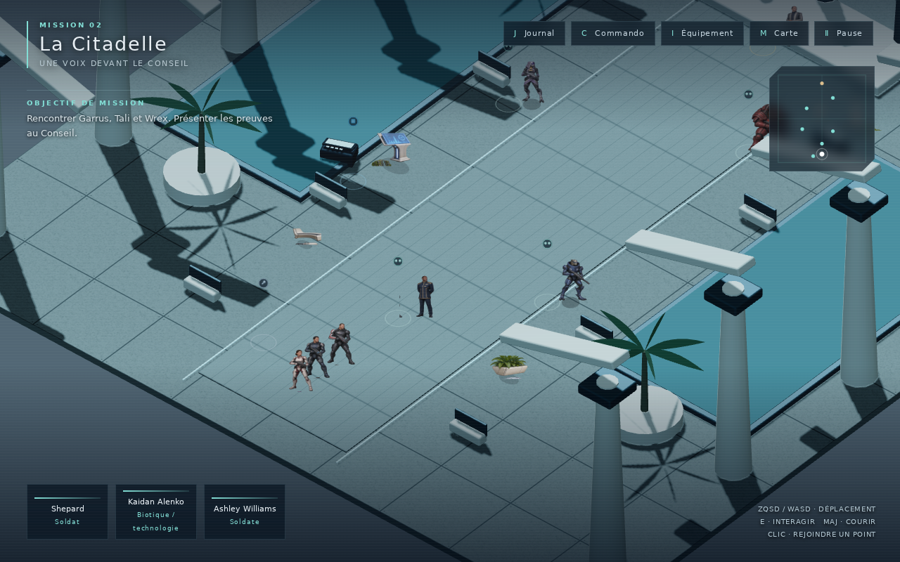
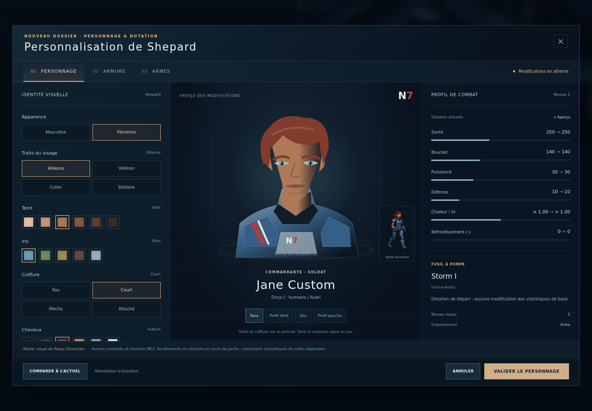

# Mass Effect — Relay Chronicles

Un RPG de fan en français : **personnages en sprites 2D, décors 3D, groupe de trois et commandes ATB**, dans une mise en scène inspirée des JRPG sur PlayStation.

**Version 0.3.0 : atelier de personnalisation du personnage, de l’armure et des armes.** La campagne ME1 condensée, ses 14 assignations, l’inventaire à neuf emplacements, les animations de Shepard et les Chroniques indépendantes restent présents. Ce dépôt contient le jeu, ses assets, son catalogue de production et son classeur Excel. La reconstitution intégrale de Mass Effect avec fidélité 1:1 reste un objectif de production ; les cartes, dialogues et rencontres actuels sont des adaptations explicitement suivies dans le catalogue.



## Jouer

Prérequis : Node.js 22.12+ ou 24, npm, un navigateur récent avec WebGL 2. Le jeu ne demande ni compte ni serveur de données. Les sauvegardes restent sur l’appareil et peuvent être exportées en JSON.

```bash
git clone https://github.com/darknigthmare/Mass-Effect-Relay-Chronicles.git
cd Mass-Effect-Relay-Chronicles
npm ci
npm run dev
```

Ouvrir l’adresse affichée dans le terminal, puis **Nouvelle campagne**. Dans le Normandy, rejoindre le **briefing**, puis choisir **Eden Prime** sur la carte galactique. Les marqueurs se rejoignent aussi au clic.

### Application PC

```bash
npm run desktop
```

Electron ouvre le jeu dans une fenêtre dédiée. **F11** bascule le plein écran. Pour créer un dossier d’application sur sa plateforme :

```bash
npm run package:desktop
```

La commande `package:windows` produit un exécutable portable Windows x64 dans `release/`. Les workflows GitHub construisent également le jeu web et l’application Windows ; leurs résultats se trouvent dans les artefacts des exécutions réussies de l’onglet **[Actions](https://github.com/darknigthmare/Mass-Effect-Relay-Chronicles/actions)**. Le [rapport de compilation locale](docs/qa/build-report.json) identifie le build web 0.2.0 et ses sources. Le [binaire local historique](docs/qa/build-v0.1.0-report.json) concerne la version 0.1.0. Le lancement sur Windows reste à vérifier.

### Version de distribution web

```bash
npm run build
npm run preview
```

Le dossier `dist/` contient la version web compilée avec tous les assets locaux. Le servir par HTTP ; le double-clic sur `index.html` n’est pas le mode de lancement prévu. La version Electron charge ces mêmes fichiers localement.

Le [rapport initial de livraison 0.3.0](docs/qa/v0.3.0-report.json) conserve les vérifications de la branche de personnalisation avant sa fusion avec les dernières Chroniques.

## Commandes

| Action | Commande |
|---|---|
| Se déplacer | ZQSD, WASD ou flèches |
| Courir | Majuscule |
| Interagir | E, bouton à l’écran ou clic sur un marqueur |
| Se rendre à un endroit | Clic sur le sol ; recherche de chemin avec collisions |
| Journal / équipe / équipement | J / C / I |
| Carte locale | M |
| Carte galactique | G au Normandy après le briefing |
| Pause / fermer un menu | Échap |
| Sélectionner un équipier en combat | 1 / 2 / 3 |
| Tir rapide d’un équipier prêt | Espace |
| Pouvoir ou action ciblée | Choisir une commande, puis une cible |

En mode **Attente**, le temps se suspend lorsqu’un allié peut agir. En mode **Actif**, les jauges continuent. La pause arrête aussi les recharges et la chaleur. Les options proposent trois difficultés, le volume, des transitions réduites et du texte agrandi.

## Personnaliser Shepard

À la création, ouvrir **Personnaliser l’apparence**. En cours de campagne, l’atelier est accessible depuis **Pause**, **Commando** et **Équipement**, hors combat.

| Onglet | Choix disponibles |
|---|---|
| Personnage | Apparence masculine ou féminine, quatre préréglages de visage, six teints, cinq couleurs d’yeux, six couleurs de cheveux et quatre coiffures |
| Armure | Armure complète et module possédés, trois canaux de couleur, quatre motifs, trois finitions et casque masqué, visible ou réservé au combat |
| Armes | Arme, module d’arme et amélioration de munitions ; filtres et consultation du catalogue, avec disponibilité et restrictions expliquées |

Les changements restent dans un **brouillon** jusqu’à la validation. La comparaison montre la configuration actuelle et les statistiques calculées ; **Annuler** ou **Échap** abandonne les retouches. L’application valide les neuf emplacements ensemble contre l’inventaire courant. Elle ne crée ni objet ni crédit. Les couleurs sont cosmétiques ; l’équipement conserve ses effets réels en combat. Les choix sont conservés dans les sauvegardes automatiques, manuelles et exportées.



Le portrait détaillé est un dessin 2D de conception. Le mannequin réutilise le vrai sprite dans quatre directions ; les couleurs, motifs, finitions et réglages du casque sont transmis au rendu du terrain. Les formes de visage et de coiffure restent visibles sur le portrait de l’atelier. Les silhouettes exactes de chaque armure et de chaque arme restent à produire. Les ensembles complets et modules suivent l’organisation ME1 ; les revêtements et la retouche pendant la campagne sont des extensions de cette adaptation. Voir [le périmètre de personnalisation](docs/CUSTOMIZATION.md) et [les références par opus](docs/research/customization-sources.md).

## Contenu effectivement présent

- **9 zones 3D**, dont deux états de la Citadelle : Normandy, Eden Prime, Citadelle, Thérum, Féros, Novéria, Virmire, Ilos et Citadelle assiégée.
- **8 étapes de campagne**, **21 rencontres de campagne**, **63 points de mission**, **9 emplacements de conversation conditionnels** au Normandy et **4 contacts des assignations historiques** à la Citadelle, complétés par les marqueurs des nouvelles opérations.
- Shepard et six compagnons permanents possibles, avec Jenkins au départ ; **6 classes** pour Shepard.
- Recrutement, choix de deux compagnons, expérience, niveaux, crédits et calibrations. Inventaire partagé de 150 objets, 52 références achetables, neuf emplacements par personnage, formations d’armure explicites et effets d’équipement en combat.
- Tirs à chauffe, couverture, pouvoirs biotiques, technologie, attaques organiques, états temporaires et soin.
- Décisions enregistrées pour Féros, la reine rachni, Virmire et le Conseil.
- Journal, 16 entrées de codex à découverte progressive avec recherche, carte galactique, radar, carte locale et sauvegarde avec import/export.
- Conversations avec Nihlus, Joker, Chakwas et les six compagnons, selon leur recrutement, leur survie et les événements connus. Le conseil donné à Garrus est mémorisé et repris dans un échange ultérieur.
- Quatorze assignations : Retour à la maison, Affaire familiale et Le Fan sont conservées ; onze opérations supplémentaires ajoutent 43 étapes à la Citadelle et sur Féros, avec quatre combats annexes. Le journal conserve étapes, choix, conditions et récompenses uniques.
- Atlas HD du commando, d’ennemis, de boss, de PNJ, d’objets et de véhicules ; 16 images de marche pour chaque apparence de Shepard et quatre poses de combat féminines.
- Ambiances et effets générés localement par Web Audio.

Le dossier de Shepard permet de choisir une apparence masculine ou féminine, les trois origines et les trois profils psychologiques. Ces choix sont conservés dans les sauvegardes et consultables depuis la pause ou le commando. Les portraits et sprites suivent l’apparence choisie en exploration et en combat. La variante féminine utilise désormais un cycle de marche dans quatre directions et des poses de visée, pouvoir, impact et hors combat. Les atlas et transitions restent au stade Prototype.

Six emplacements de sauvegarde manuelle sont accessibles depuis le titre et la pause. Chaque emplacement conserve un nom, une date, une zone et l’identité du commandant. Un remplacement ou une suppression demande confirmation. Ces emplacements restent séparés de la sauvegarde automatique ; le chargement et l’enregistrement sont indisponibles en combat.

À la Citadelle, Garrus et Wrex peuvent être recrutés immédiatement ou lors d’un retour après le Conseil. Les preuves de Tali suffisent à obtenir l’audience. Le recrutement ne remplace pas automatiquement le commando sélectionné. Au Normandy, les compagnons disponibles sont stationnés à leur emplacement de conversation ; les mêmes échanges sont accessibles depuis le menu Commando.

Les assignations utilisent des dialogues concis et des cartes condensées ; les variantes et contrôles de persuasion complets restent à reconstituer. Les trois premières conservent leur récompense de 50 XP. Les valeurs des opérations et des équipements sont des réglages de l’adaptation ATB. La [note de version 0.2.0](docs/RELEASE_0.2.0.md) détaille cette livraison ; le [complément équipement](docs/research/loadout-extension-sources.md) conserve ses 48 objets et ajoute quatre outils, les seconds ports de mods et la migration des anciennes parties. Les véhicules servent actuellement de décor. Les autres missions annexes, DLC, romances, dialogues complets et campagnes intégrales ME2/ME3/Andromeda restent à réaliser. Le [suivi de fidélité](docs/FIDELITY.md) distingue les fonctions livrées des références et contenus encore nécessaires.

## Chroniques indépendantes

Depuis le titre ou la pause, **Chroniques** ouvre un registre de **28 œuvres et 48 segments** avec sources et conditions de présence. **Seize essais ATB** sont proposés dans ME2, ME3, Andromeda, Infiltrator, Galaxy, Redemption et Paragon Lost : quatre oppositions à types d’adversaires référencés, neuf bancs à mannequins originaux et trois ateliers d’équipement. Les six bancs supplémentaires réservent les personnages DLC ou bonus à leur contexte explicite. Les **42 profils partiels sont sélectionnables dans leurs essais autorisés**. Les ateliers proposent **76 équipements : 64 armes, 10 armures et deux familles de modules ME3**.

Shepard dispose de six préparations de classe dans ME2 et de six dans ME3 ; Ryder de trois préparations de compétences, en plus des dotations par défaut. Les **61 fiches de pouvoirs exposées correspondent à 30 commandes ATB**, auxquelles s’ajoute la désactivation du mode de munitions. Le lot actuel raccorde quatre fiches de soutien à trois actions — drone de combat, tourelle de garde et drone de défense — et dix fiches de munitions ME2/ME3 à six modes exclusifs. Les soutiens ont leurs propres PV, une durée et un propriétaire ; ils peuvent être détruits et ne comptent pas comme équipiers pour la victoire. Les modes appris s’appliquent aux seuls tirs conventionnels à clips, sans remplir le chargeur ni renforcer les pouvoirs. Les consommables de munitions Andromeda et Warp Ammo ME3 restent fermés. Les paramètres sont adaptés à l’ATB ; talents, rangs et acquisitions d’origine restent partiels.

Les grenades à fragmentation et collantes disposent d’une réserve d’essai limitée, distincte des munitions de l’arme ; le soutien des boucliers de Cora restaure les alliés conscients. Les deux ports de modules restent limités aux familles et armes compatibles. Le lot soutiens, munitions et portraits a passé **473 tests Node sur main `cefa0b1`**, la compilation et **cinq contrôles navigateur** ; ses **douze contrôles de production HTTP** chargent les onze PNG. Le [rapport du lot](docs/qa/chronicle-support-report.json) conserve les résultats et leurs limites ; les rapports historiques décrivent leurs propres versions.

Six armes spéciales ajoutent des explosions différées, des salves énergétiques et des canalisations : Falcon et Scorpion dans ME3 ; Scorpion, P.A.W., Reegar et Sweeper dans Andromeda. Les jauges de chaleur et les clips sont distincts ; une canalisation peut être interrompue. Les paramètres sont adaptés à l’ATB et les mécanismes originaux ne sont pas certifiés intégralement.

L’onglet **Lecture** propose **seize parcours documentaires et 52 pages sourcées**. Les ajouts couvrent les repères et contradictions de Deception, le quatrième numéro de Homeworlds, le cinquième de Foundation, Discovery, Incursion, Inquisition et le début d’Evolution. Chaque parcours reste limité aux faits établis de son segment, sans dialogue canonique inventé, issue alternative ou récompense. La présence d’un personnage dans ces lectures ne le rend pas sélectionnable en combat.

L’œuvre, le segment, le porteur et les règles de l’essai limitent chaque sélection. Les ateliers utilisent une préparation libre et des valeurs ATB adaptées ; l’acquisition et les conditions de déblocage d’origine restent à reproduire. Les alternatives Samara/Morinth et Ashley/Kaidan sont exclusives. Les dossiers ME4, Library Edition, Blasto et contenus coupés restent documentaires, sans période historique jouable.

Les Chroniques possèdent leurs propres sauvegardes et exports, sans transfert vers la campagne ME1. Les anciennes préparations v1 à deux emplacements migrent vers quatre : arme, armure et deux modules d’arme. Le mode de munitions préparé est conservé dans `ammoModes`, avec validation du personnage, de l’œuvre et de l’arme ; l’activer pendant une escarmouche ne réécrit pas la préparation. La lecture reprend sa page dans `readingProgress`, séparément des notes personnelles. Un nouvel atlas fournit trois bustes de prototype : Miranda ME2, Thane ME2 et Garrus ME3, uniquement dans leurs contextes autorisés. Les autres profils conservent leurs symboles ; ces bustes n’ajoutent ni sprites en pied, ni huit directions, ni animations. Voir [le périmètre, les essais, les lectures et les limites](docs/CHRONICLES.md).

## Excel et documentation

- **[27 classeurs supplémentaires — univers étendu](docs/universe/README.md)** : ME2, ME3, Andromeda, Infiltrator, Galaxy, les sept romans, les douze comics et collections demandés, Paragon Lost, le dossier d’extrapolation ME4 et les contenus coupés. Chaque classeur contient 28 onglets, ses sources et sa couverture restante.
- **[Télécharger les 27 classeurs en ZIP](docs/universe/outputs/relay-chronicles-20261022/Mass_Effect_Universe_27_Classeurs.zip)**.
- **[Classeur de production — 1 380 fiches, 28 onglets](docs/Mass_Effect_Relay_Chronicles_Production.xlsx)** : décors, mondes, cartes, connexions, personnages, PNJ, ennemis, boss, armes, pouvoirs, movesets, missions, choix, animations, sprites, audio, VFX, interface et QA. La version 0.3.0 ajoute 50 fiches de personnalisation en conservant les 1 330 fiches de la branche principale, soit 6 706 références avec les 27 catalogues supplémentaires.
- [Guide et décompte du catalogue](docs/CATALOGUE.md).
- [Catalogue JSON](docs/content-catalog.json), utilisé pour générer le classeur.
- [Chroniques : périodes, personnages, équipement et sauvegardes séparées](docs/CHRONICLES.md).
- [Conception du jeu et architecture](docs/DESIGN.md).
- [Registre des assets et limites artistiques](docs/ASSETS.md).
- [État de livraison et vérifications](docs/IMPLEMENTATION_STATUS.md).

**Une fiche de production ne signifie pas un élément terminé.** Le classeur sépare le statut du contenu, le statut de l’asset et le niveau de vérification canonique. Les liens vers des fichiers constituent des preuves localisables ; les noms d’assets futurs restent dans une colonne distincte. Une modification directe dans Excel n’est pas automatiquement réimportée dans le JSON.

## Développement et vérification

La configuration de publication web est disponible dans [vercel.json](vercel.json). Voir [relier le dépôt à Vercel](docs/DEPLOYMENT.md) pour l’intégration Git et l’état des accès cloud.

```bash
npm test
npm run build
```

Les tests Node vérifient le combat, l’équipement, la personnalisation, les opérations, les sauvegardes, les Chroniques et la portabilité Windows. Le [rapport initial de personnalisation](docs/qa/customization-unit-report.json) conserve ses 217 tests historiques ; il ne décrit pas la validation de cette fusion. La synchronisation actuelle au socle `cefa0b1` passe **492 tests Node**, la compilation, **neuf contrôles de personnalisation** et **douze contrôles HTTP de production**, sans erreur JavaScript ni requête échouée. Ses contrôles récents sont conservés dans [customization-support-sync-report.json](docs/qa/customization-support-sync-report.json). La fusion précédente au socle `748b965` conserve ses 415 tests Node, neuf contrôles de personnalisation et dix contrôles HTTP dans [pr1-final-report.json](docs/qa/pr1-final-report.json) ; ce rapport est historique. Le [premier rapport de fusion](docs/qa/pr1-merge-report.json) conserve les 377 tests de `0d2192a` sur l’ancienne base `7fe7a88`. Les tests navigateur requièrent Playwright et Chromium :

```bash
npx playwright install chromium
npm run dev
# Dans un autre terminal :
npm run test:browser
npm run test:campaign
npm run test:world
npm run test:commander
npm run test:saves
npm run test:story
npm run test:assignments
npm run test:operations
npm run test:loadout
npm run test:customization
npm run test:loadout:extensions
npm run test:universe
npm run test:chronicle:expansion
npm run test:chronicle:specialists
```

Variables facultatives : `GAME_URL` pour changer le serveur testé, `PLAYWRIGHT_EXECUTABLE_PATH` pour un Chromium existant. `RELAY_QA=1` coupe le rechargement automatique du serveur pendant un parcours. Les tests de campagne accélèrent le temps simulé ; ils ne remplacent pas les dégâts, les statistiques ou les conditions de progression. Les captures et rapports historiques sont écrits dans `test-results/`. Le parcours de personnalisation consigne ses preuves dans `docs/qa/customization-report.json` et `docs/screenshots/customization-*.png`.

Après `npm run build`, `node scripts/production-v02-browser.mjs` vérifie les ressources et la reprise du build sous URLs locales dans Chromium. `node scripts/femshep-poses-browser.mjs` inspecte les quatre poses dans une scène de rendu isolée avec le serveur dev actif. Ces contrôles ne remplacent pas un lancement de l’exécutable Windows.

`npm run test:assignments -- --late-conrad` vérifie le premier contact avec Conrad après deux missions et l’attente d’une nouvelle mission, y compris après rechargement.

`npm run audit:fidelity` produit dans `test-results/fidelity-report.json` la liste des fiches restantes du classeur principal, leurs critères et leurs preuves locales. Ajouter `-- --include-universe` pour inclure les 27 catalogues supplémentaires. Cet audit ne modifie aucun statut et ne certifie pas la fidélité canonique.

`npm run build:universe` régénère le registre documentaire du jeu depuis les 28 catalogues. `npm run build:universe -- --check` vérifie sa correspondance sans écrire. Cette commande ne modifie ni les sources JSON ni les classeurs.

Le classeur livré est directement ouvrable dans un tableur. Sa régénération avec `npm run workbook` requiert le runtime `@oai/artifact-tool` et sa variable `CODEX_PRIMARY_RUNTIME_NODE_MODULES` ; cette dépendance d’édition n’est pas nécessaire pour jouer ou compiler le jeu.

La génération historique de l’extension ciblée 0.3.0 utilise `scripts/update-customization-catalog.mjs` et `scripts/update-customization-workbook.mjs` sur la base indiquée dans ces scripts. Elle préserve les feuilles, cellules et styles antérieurs. Les résultats de recalcul, de comparaison des cellules et de contrôle des tableaux se trouvent dans [customization-verification.json](docs/workbook-previews/customization-verification.json) et [customization-native-check.json](docs/workbook-previews/customization-native-check.json). Le [premier contrôle de fusion](docs/workbook-previews/customization-merge-native-check.json) reste historique ; le classeur actuel est vérifié dans [customization-support-sync-workbook-report.json](docs/qa/customization-support-sync-workbook-report.json).

## Structure

| Chemin | Responsabilité |
|---|---|
| `src/main.js` | Écrans, dialogues, transitions et orchestration |
| `src/world.js` | Rendu Three.js, navigation, collisions, sprites et VFX |
| `src/world-data.js` | Zones et points d’intérêt |
| `src/combat.js` | Simulation ATB indépendante du rendu |
| `src/state.js` | Progression, achats, recrutement et validation des sauvegardes |
| `src/story.js` | Conversations, découvertes du codex et historique narratif sauvegardé |
| `src/story-data.js` | Sujets de conversation réécrits et entrées conditionnelles du codex |
| `src/assignments.js` | Assignations, étapes, issues, récompenses uniques et validation des sauvegardes |
| `src/assignment-data.js` | Contacts et dialogues condensés des trois assignations de la Citadelle |
| `src/operations.js` / `src/operation-data.js` | Onze opérations supplémentaires, 43 étapes, quatre combats et validation persistante |
| `src/loadout.js` / `src/loadout-ui.js` | Inventaire, boutiques, compatibilité, effets de matériel et comparaisons |
| `src/customization.js` | Options cosmétiques, brouillon détaché, validation et application atomique |
| `src/customization-ui.js` / `src/customization-ui.css` | Atelier Personnage / Armure / Armes, comparaison et aperçu dans quatre directions |
| `src/customization-render.js` | Traitement des pixels partagé entre l’aperçu et les sprites du monde |
| `src/continuity-data.js` / `src/continuity.js` | Œuvres, segments, provenance et validation des contextes |
| `src/universe-data.js` | Registre documentaire généré depuis les 28 catalogues |
| `src/universe-actors.js` / `src/universe-equipment.js` | Profils partiels, préparations et équipement autorisés dans les essais |
| `src/universe-powers.js` | Liaisons sourcées entre pouvoirs, personnages et commandes ATB |
| `src/combat-summons.js` / `src/universe-ammo.js` | Plans d’invocation et modes de munitions adaptés, raccordés au vrai combat |
| `src/universe-portraits.js` | Trois bustes de prototype associés aux identités et contextes exacts |
| `src/chronicle-story.js` | Seize parcours documentaires, sources et découvertes par page |
| `src/chronicles.js` / `src/universe-ui.js` | Chroniques indépendantes, préparation, combat et sauvegardes séparées |
| `src/local-map.js` | Carte numérotée avec filtres et suivi |
| `src/game-data.js` | Classes, personnages, rencontres, calibrations et codex |
| `src/audio.js` | Audio procédural local |
| `public/assets/` | Images et manifestes des atlas |
| `desktop/` | Application Electron |
| `docs/` | Excel, catalogue, conception, preuves et captures |

## Crédits

Projet de fan indépendant réalisé pour Darknigthmare. Univers, noms et personnages Mass Effect : BioWare / Electronic Arts. Les dialogues, chiffres d’équilibrage, arrangements de cartes et système ATB de ce prototype sont des adaptations. Les images ont été générées pour ce projet et demandent encore un contrôle artistique contre les références de ME1. Aucun statut « fidélité 1:1 validée » n’est revendiqué pour ces atlas.
