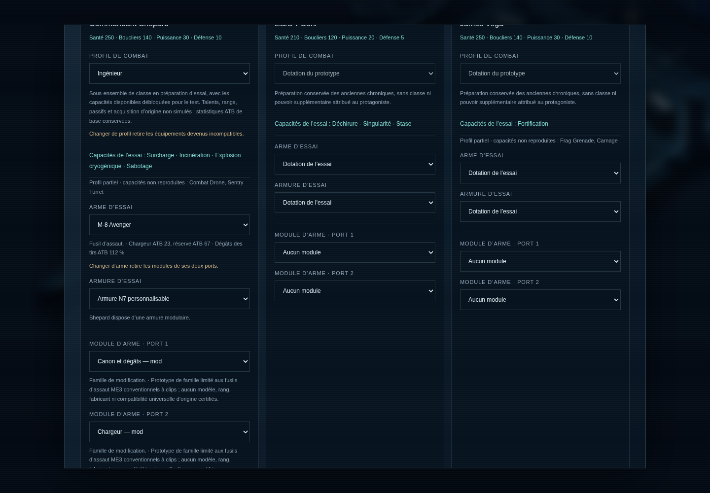
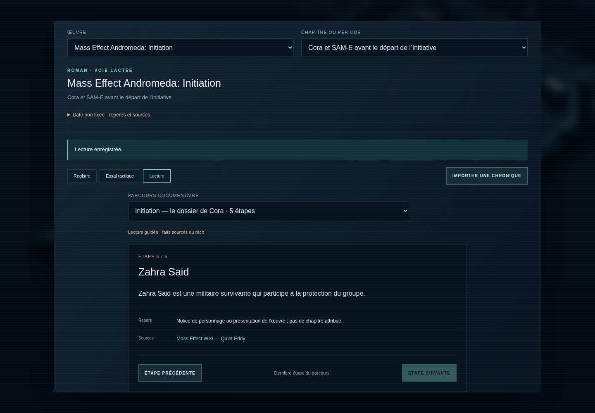

# Chroniques — œuvres, segments et essais tactiques

Les **Chroniques** ouvrent un registre de 28 œuvres et 48 segments explicites, puis dix essais ATB indépendants dans sept œuvres : Mass Effect 2, Mass Effect 3, Andromeda, Infiltrator, Galaxy, Redemption et Paragon Lost. Neuf parcours documentaires ajoutent 42 pages de lecture dans des contextes de romans et comics. La campagne ME1 conserve ses cartes, son commando, son inventaire et ses sauvegardes.

**État documentaire du complément du 24 octobre 2026, basé sur `994a963`.** Le socle main rassemblait **6 656 fiches : 1 330 dans le principal et 5 326 dans les 27 catalogues supplémentaires**. La fusion de personnalisation 0.3.0 conserve ces fiches et ajoute les 50 entrées de la PR : **6 706 références, dont 1 380 principales**. Les 85 nouvelles fiches passées au stade Prototype dans les catalogues supplémentaires concernent 40 fiches de pouvoirs, deux familles de modules et 43 références documentaires de lieux, récit ou continuité. Les identifiants de sources, la nature et les descriptions des fiches sont conservés. Une fiche conservée dans ce registre ne devient pas automatiquement visible, sélectionnable ou jouable. L’interface ne présente que les références dont la provenance autorise le segment choisi. Les campagnes intégrales, dialogues, cartes et scènes des œuvres supplémentaires restent à produire ; aucune fidélité 1:1 n’est certifiée par ces essais.

## Ouvrir une chronique

Depuis le titre ou la pause de la campagne, choisir **Chroniques**, puis une **œuvre** et un **chapitre ou une période**.

- **Registre** : rechercher parmi les personnages, équipements, pouvoirs, récits et lieux autorisés. Une fiche affiche son statut, ses conditions, ses repères et ses sources.
- **Essai tactique** : choisir l’essai proposé, préparer un groupe d’un à trois personnages, puis lancer l’escarmouche. Certains contextes proposent seulement des références.
- Dans les trois ateliers, choisir un profil de combat disponible, une arme et, pour le protagoniste autorisé, une armure. Les modules compatibles disposent de deux ports ; les choix incompatibles restent indisponibles avec leur motif.
- **Lecture** : ouvrir le parcours documentaire du segment, avancer ou revenir parmi ses pages et consulter leurs sources. La page atteinte est enregistrée sans récompense ni choix ajouté au récit.
- Enregistrer, reprendre, exporter ou importer la chronique depuis ce même espace. Le retour ramène au titre ou à la pause de la campagne.

Les combats utilisent le mode Attente. Les armes conventionnelles des profils ME2, ME3 et Andromeda emploient un chargeur et une réserve ; **Recharger** consomme une action ATB. Les capacités, statistiques, réserves et adversaires des essais suivent les réglages de ce prototype.

Les **34 profils sélectionnables sont comptés par œuvre** : un même personnage peut avoir plusieurs profils distincts selon son contexte. Les capacités manquantes restent signalées dans chaque préparation.

## Dix essais, trois périmètres

| Œuvre et segment | Essai | Périmètre réalisé |
|---|---|---|
| ME2 · `me2` | Freedom’s Progress — sécurité mécanique | Shepard, Miranda et Jacob face à des LOKI référencés ; rencontre condensée |
| ME3 · `me3-prologue` | Terre — banc du prologue | Shepard et Anderson face à des mannequins originaux ; aucune rencontre du prologue reproduite |
| Andromeda · `mea-prologue` | Habitat 7 — banc de personnages | Ryder et Alec face à des mannequins originaux ; aucune rencontre de la mission reproduite |
| Infiltrator · `inf` | Fuite face à Cerberus | Randall face aux types soldat et mech documentés, dans une opposition ATB condensée |
| Galaxy · `gal` | Intervention de Jacob | Jacob face aux types robot et adversaire turien documentés ; exercice sans attribution à une rencontre précise |
| Paragon Lost · `pl-collectors` | Crise des Récolteurs | Vega face à un Récolteur de prototype ; les autres membres de Delta Squad restent exclus faute de fenêtre de présence vérifiée |
| Redemption · `red` | Banc de personnages | Liara et Feron face à des mannequins originaux ; aucun événement ou adversaire du comic rejoué |
| ME2 · `me2` | Atelier d’équipement | Groupe de test et matériel autorisé de ME2 face à des cibles originales |
| ME3 · `me3` | Atelier d’équipement | Groupe de test et matériel autorisé de ME3 face à des cibles originales |
| Andromeda · `mea` | Atelier d’équipement | Groupe de test et matériel autorisé d’Andromeda face à des cibles originales |

Cela représente **quatre oppositions à types d’adversaires référencés**, **trois bancs à cibles abstraites** et **trois ateliers d’équipement**. Les effectifs, cartes de combat, durées, valeurs et commandes ATB sont adaptés. Une victoire enregistre la réussite de l’essai ; elle n’accorde ni crédits, ni expérience, ni choix canoniques à la campagne.

## Présence des personnages et du matériel

Les dix essais exposent **34 profils de personnages sélectionnables au total**, parmi **42 profils de combat partiels définis**. Un même personnage dans deux œuvres possède deux identifiants distincts. Les profils supplémentaires ne sont pas tous sélectionnables : il faut aussi une autorisation dans l’essai choisi. Les pouvoirs absents du moteur ou insuffisamment documentés ne sont pas ajoutés par analogie.

Les ateliers proposent **70 équipements sélectionnables** : 11 dans ME2, 29 dans ME3 et 30 dans Andromeda, soit **58 armes, 10 armures et deux familles de modules**. Chaque modèle doit satisfaire simultanément les conditions de l’œuvre, du segment, de l’essai, du porteur et des mécaniques disponibles. Les armures personnelles sont réservées à Shepard ou Ryder selon l’œuvre. Les armes lourdes, tirs chargés, rayons, technologies reliquates, variantes d’édition et autres mécanismes non reproduits restent des références fermées lorsque leur fonctionnement manque.

La préparation d’atelier est libre. Elle ne simule pas l’acquisition d’origine, le recrutement, les arbres détaillés de talents, les rangs, les bonus passifs, les ressources, les achats, les crédits ou le butin. L’atelier utilise un état de test où les compagnons proposés ont rejoint le groupe et survécu ; les conditions de leurs fiches restent consultables. Les alternatives sont conservées : **Samara/Morinth** et **Ashley/Kaidan** ne peuvent pas être sélectionnés ensemble. Anderson et Alec restent limités à leurs bancs de prologue.

Les bonus d’armure, profils de familles d’armes, chargeurs et pouvoirs utilisent des valeurs ATB adaptées. La cadence, la dispersion, les sons, les améliorations détaillées et les variantes de chaque modèle ne sont pas reproduits intégralement.

## Pouvoirs et préparations

Le complément ajoute **dix mécaniques ATB** : Attraction, Incinération, Explosion cryogénique, Tir percutant, Drain d’énergie, Fortification, Ravage, Onde de choc, Écrasement et Domination. **40 fiches de pouvoirs supplémentaires** sont utilisées avec ces nouvelles commandes ou des commandes déjà présentes ; ce nombre ne correspond pas à 40 actions distinctes. Les protections, cibles, durées, états et variantes ME2/ME3 restent des réglages explicitement adaptés. Les pouvoirs de loyauté ME2 ne sont proposés que dans l’atelier correspondant, préparé dans un état après loyauté.

Shepard peut choisir les **six classes dans ME2 et les six classes dans ME3**, en plus de la dotation par défaut conservée pour les anciennes sessions. Ryder dispose de **trois préparations de compétences — combat, biotique, technologie — et de sa dotation par défaut**. Ces préparations ne reproduisent ni tout l’arbre des talents ni les bonus passifs des profils d’Andromeda. Les compagnons gardent leur kit autorisé et les bancs de prologue gardent leur dotation par défaut. Les capacités manquantes restent affichées.

Deux **familles de modules ME3**, canon et chargeur, utilisent les ports `weaponMod` et `weaponMod2`. Elles demandent une arme ME3 de famille fusil d’assaut à clips, explicitement équipée dans l’atelier. Les deux familles peuvent coexister ; dupliquer une famille est refusé avec un motif par port. Il ne s’agit pas de nouveaux rangs ou modèles officiels certifiés. Le canon multiplie les dégâts des tirs par 1,12 sans renforcer les pouvoirs. Le chargeur conserve le total de munitions : l’Avenger passe de 18/72 à 23/67 dans ce réglage ATB. Remplacer ou retirer l’arme retire ses modules ; sélectionner la même arme les conserve.

## Neuf parcours documentaires

L’onglet Lecture présente des **paraphrases courtes de faits établis**. Les pages s’appuient sur des fiches et sources identifiées ; l’interface affiche leurs titres, liens et repères. L’ordre des pages guide la lecture ; il ne constitue pas un découpage exhaustif des chapitres ou cases. Aucun dialogue canonique, choix alternatif, personnage de combat, butin ou récompense n’est créé pour ces parcours.

| Œuvre et segment exact | Parcours | Pages |
|---|---|---|
| Revelation · `rev` | Le dossier Sidon | 5 |
| Ascension · `asc` | Protéger Gillian | 5 |
| Retribution · `ret` | La disparition de Grayson | 5 |
| Nexus Uprising · `nex` | Une station en crise | 5 |
| Initiation · `ini` | Le dossier de Cora | 5 |
| Annihilation · `ann` | Pendant le voyage | 5 |
| Redemption · `red` | La recherche de Liara | 5 |
| Invasion · `inv` | La défense d’Omega | 3 |
| Evolution · `evo-aftermath` | Après les hostilités | 4 |

Les **42 pages** s’appuient sur 63 fiches, dont 43 références documentaires de lieux, récit ou continuité suivies par les nouvelles promotions Prototype. Les fiches d’identité citées gardent leur statut documentaire : aucun acteur de roman n’est rendu combattant par la présence de son nom. Les descriptions, natures et sources d’origine restent conservées. Les fenêtres d’Homeworlds et Foundation ne sont pas fusionnées ; aucun parcours global d’anthologie n’est ajouté. Evolution reste limité aux numéros après les hostilités, Annihilation au transit de l’arche et Initiation à sa préquelle en Voie lactée.

## Continuité et incertitudes

Un contexte est un triplet strict `{mediaId, periodId, galaxy}`. La galaxie provient du registre ; une année libre ou une plage chronologique approximative ne donne aucun accès supplémentaire. Une fiche ME3 n’entre pas dans ME1 parce qu’un personnage ou un nom d’arme existe dans les deux épisodes.

Les anthologies sont découpées explicitement : six segments pour Homeworlds, treize pour Foundation. Les deux phases d’Evolution et de Paragon Lost sont séparées. Une notice de recueil confirmant un personnage ne suffit pas à placer sa jeunesse, son équipement ou ses compagnons dans chaque scène. Les associations de scène non vérifiées restent fermées. Les modules multijoueurs de ME3 original et APEX ne fournissent pas de compagnons aux groupes solo.

Annihilation possède son propre contexte de transit, avec un lieu non fixé : il n’est pas assimilé à une mission dans Heleus. Discovery et Initiation gardent leurs contextes de préquelle en Voie lactée. Les réserves documentaires et contradictions restent affichées avec les sources.

Quatre dossiers ne proposent aucune période historique ni essai :

| Dossier | Limite |
|---|---|
| ME4 | Contenu spéculatif ou période non établie ; aucune campagne officielle reconstituée |
| Library Edition | Compilation éditoriale ; les périodes appartiennent aux récits rassemblés |
| Blasto | Fiction à l’intérieur de l’univers, sans conversion en événement historique |
| Contenus coupés | Archives et concepts, sans insertion automatique dans la continuité publiée |

Ces dossiers restent présents dans la liste avec leur motif de fermeture et leurs catalogues documentaires. Les statuts, natures et sources des fiches sont conservés ; les tests fonctionnels ne les promeuvent pas en contenus certifiés.

## Sauvegardes séparées

Une chronique est enregistrée par couple œuvre/segment sous une clé locale propre : `relay-chronicles.chronicle.<mediaId>.<periodId>.v1`. Elle conserve le scénario actif, le groupe, les profils `builds`, les quatre emplacements de préparation et les essais réussis. Les anciennes sessions v1 à deux emplacements migrent automatiquement vers `weapon`, `armor`, `weaponMod` et `weaponMod2`, avec les deux ports supplémentaires vides. Une structure explicitement invalide reste refusée.

Les découvertes enregistrent uniquement des fiches autorisées dans le contexte. `readingProgress` conserve séparément l’index de page par parcours ; il n’écrase pas `notes`, qui reste réservé aux notes personnelles. Les anciens exports dépourvus de ces champs reçoivent leurs valeurs par défaut. L’interface ne propose pas d’éditeur de notes personnelles.

Depuis une campagne en cours, l’entrée dans Chroniques enregistre d’abord un point de reprise ME1 avec la position et le temps courants. La campagne reste ensuite figée et ses sauvegardes ne sont pas modifiées par les essais. Un rafraîchissement permet de reprendre ce point de campagne.

Les exports Chroniques utilisent le format `relay-chronicles.chronicle`. Ils sont distincts des exports de campagne `relay-chronicles`, de la sauvegarde automatique ME1 et de ses six emplacements manuels. Aucun transfert d’équipement, de crédits, de compagnon ou de progression entre ces espaces n’est fourni.

Les imports sont validés avant enregistrement : contexte exact, scénario connu, personnages autorisés, équipement compatible et structure des données. Une référence périmée ou un contenu étranger au contexte rend l’import invalide. Les erreurs de stockage sont signalées ; un enregistrement illisible est conservé et n’est pas remplacé automatiquement. Les sauvegardes ME1 publiées gardent leur version et leur contexte ME1 implicite.

## Présentation visuelle

Ce lot ne crée aucune illustration, aucun portrait ni aucun atlas. Les Chroniques emploient des symboles, initiales et effets de prototype. Les silhouettes de ME1 ne sont pas réattribuées aux nouveaux personnages. Costumes par époque, modèles d’armes, décors, portraits, sprites et animations propres à chaque œuvre restent à produire et à vérifier. Voir le [registre des assets](ASSETS.md).

## Sources, code et vérifications

| Fichier | Responsabilité |
|---|---|
| [`continuity-data.js`](../src/continuity-data.js) | Œuvres, segments explicites, réserves et règles documentaires de provenance |
| [`universe-data.js`](../src/universe-data.js) | Registre généré à partir des catalogues, sans promotion de leurs statuts |
| [`continuity.js`](../src/continuity.js) | Contexte, filtrage et validation de la base des sessions |
| [`universe-actors.js`](../src/universe-actors.js) | Profils partiels, autorisations des groupes et dix essais |
| [`universe-equipment.js`](../src/universe-equipment.js) | Matériel, quatre emplacements, compatibilité par port et effets disponibles |
| [`universe-powers.js`](../src/universe-powers.js) | Liaisons sourcées, kits, classes et conditions des pouvoirs |
| [`chronicle-story.js`](../src/chronicle-story.js) | Neuf lectures, 42 pages, provenance et découvertes validées |
| [`chronicles.js`](../src/chronicles.js) | Validation composite, préparation, combat, import/export et stockage isolé |
| [`universe-ui.js`](../src/universe-ui.js) | Registre, profils, modules, lecture et commandes des essais |

Le registre est chargé à l’ouverture des Chroniques. Les sources éditoriales restent dans le [catalogue principal](content-catalog.json), les [27 catalogues supplémentaires](universe/README.md) et leurs références. Les briefs d’adaptation et les faits sourcés restent distincts.

```bash
# Régénérer le registre du jeu depuis les catalogues :
npm run build:universe
# Vérifier qu’il correspond aux sources sans le modifier :
npm run build:universe -- --check
npm test
npm run build
# Avec un serveur local et Chromium Playwright disponibles :
npm run test:universe
npm run test:chronicle:expansion
```

Les tests dédiés couvrent continuité, provenance, personnages, matériel, rechargement, validation des sessions et isolation des sauvegardes. Le premier parcours navigateur écrit `test-results/universe-report.json` ; le complément pouvoirs, modules et lecture écrit `test-results/chronicle-expansion-report.json`. Leur résultat doit être lu dans les rapports de l’exécution concernée ; cette documentation ne certifie ni une campagne intégrale ni un lancement Windows.

Le [rapport du complément du 24 octobre 2026](qa/chronicle-expansion-report.json) relie les **358 tests réussis**, la compilation, les quatre nouveaux contrôles navigateur et les six contrôles de régression des Chroniques. Le nouveau parcours exécute les dix pouvoirs ajoutés, remporte six essais et visite les 42 pages des neuf lectures. Les 21 combats de campagne ME1 et ses reprises passent ; les 18 simulations de campagne remportent 378 combats et valident 522 sauvegardes. Le contrôle différentiel de combat ME1 conserve les mêmes événements et bilans sur 30 graines et 1 755 ordres acceptés. Les rapports historiques gardent leurs résultats et empreintes propres.

Les 28 classeurs sont vérifiés contre les catalogues. La [revue visuelle ciblée](qa/chronicle-expansion-workbook-visual-report.json) couvre 46 panneaux conservés avec leurs empreintes : elle ne constitue pas une inspection intégrale de tous leurs onglets. Les [références des pouvoirs et leurs limites](research/chronicle-power-sources.md) distinguent le manuel officiel consulté localement des attributions de compagnons issues de références secondaires.

Les **huit contrôles de production HTTP** passent avec les vrais bundles compilés, sans accès au harnais de développement : reprise de campagne, ateliers ME2 et ME3 séparés, préparation Ingénieur et ses deux modules, lecture de Revelation restaurée à sa page enregistrée. Les dix PNG et les six fichiers JavaScript chargés ont les tailles et empreintes attendues, sans requête distante ni erreur du jeu. Ce parcours Linux Chromium ne valide pas un exécutable Electron Windows ; la navigation `file://` reste bloquée par la politique du navigateur géré.




