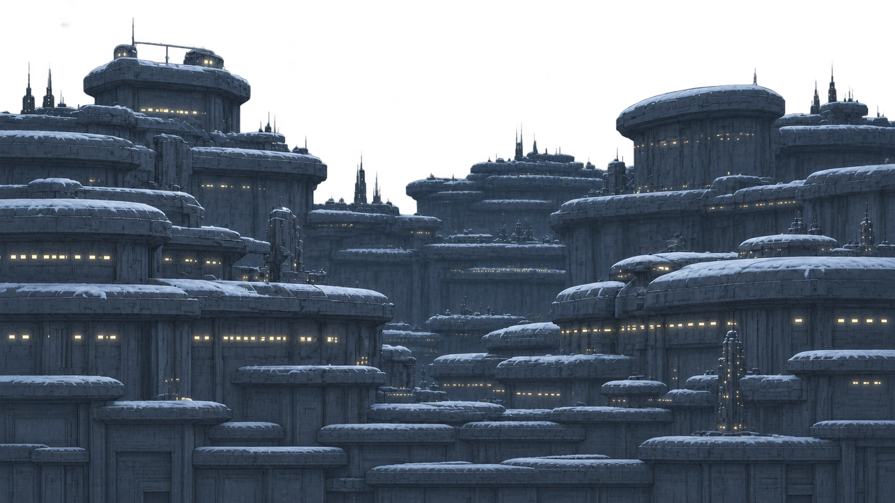
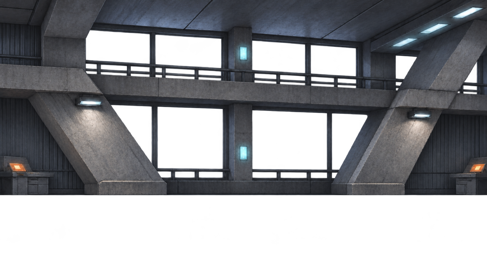
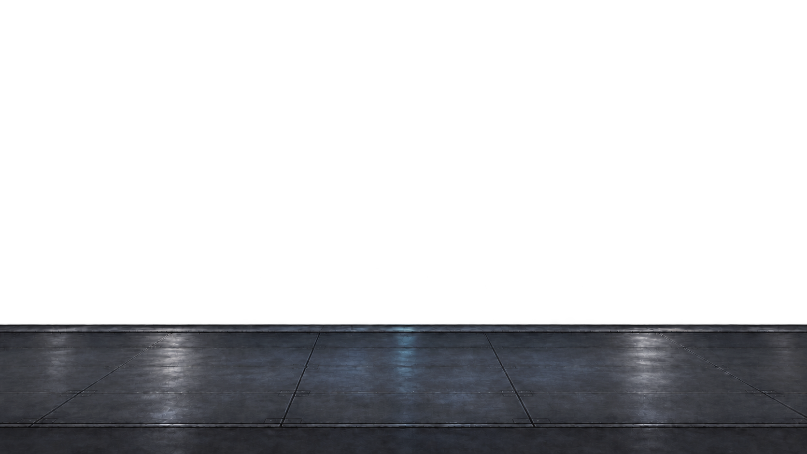
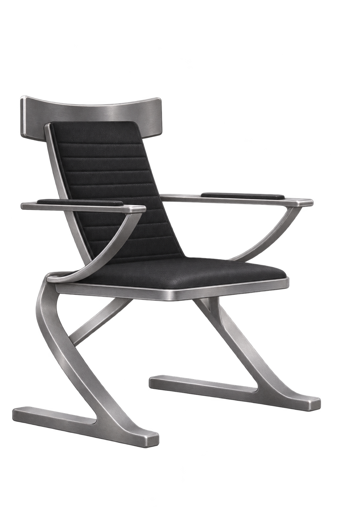
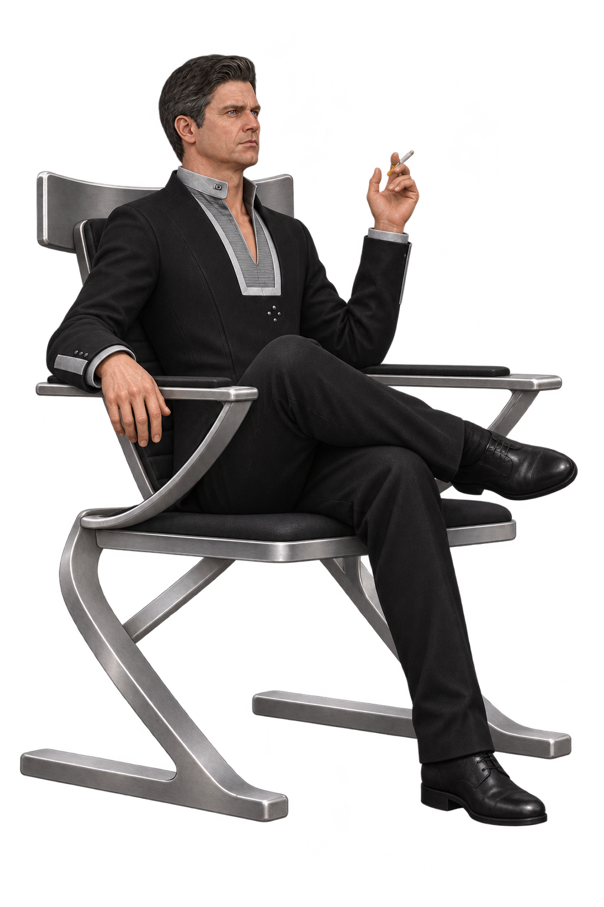

# Armax — lot 16 : Port Hanshan et l’Homme Trouble

**25 novembre 2026 — Europe/Paris.** Continuation de la production d’images fixes et de leur association à la bible du mode combat.

**6 PNG natifs pour 5 sujets : 5 versions retenues et une première version du sol conservée en historique.** Le catalogue contient **192 fiches : 132 avec une image candidate et 60 sans**. Quatre fiches de composants sont ajoutées ; la pose assise enrichit une fiche de personnage déjà illustrée. Les 188 identités héritées sont conservées.

Les fichiers annoncés au lot 15 ne sont pas récupérés. Cette livraison repart de la version publiée au commit `71955d9143562d6a44a8b8d48bc552978372bc1e`. Les 113 PNG du lot 15 ne sont pas comptés présents. Le [dossier de récupération](RECUPERATION_LOT15.md) conserve le reçu connu de l’archive et explique la pièce nécessaire à sa restauration.

## Images produites et association au jeu de combat

| Sujet | Fichier retenu | Fiches de bible | Usage et limite |
|---|---|---|---|
| Port Hanshan — PH-20 | [Architecture distante](../../../public/assets/armax/lot16/layers/port-hanshan-ph20-architecture.png) | G / J | Architecture extérieure isolée du candidat historique. L’îlot alpha détaché et certaines franges restent à reprendre. |
| Port Hanshan — PH-30 | [Structures arrière](../../../public/assets/armax/lot16/layers/port-hanshan-ph30-structures.png) | G / J | Architecture intérieure sans la masse du sol ; fenêtres et ouvertures transparentes. |
| Port Hanshan — PH-40 | [Sol R1](../../../public/assets/armax/lot16/layers/port-hanshan-ph40-floor.png) | G / J | Sol séparé, jonction améliorée après une révision. Largeur native de 1671 pixels contre 1672 pour les deux autres calques ; assemblage non validé. |
| Fauteuil de l’Homme Trouble | [Fauteuil seul](../../../public/assets/armax/lot16/props/illusive-man-me2-chair.png) | B / F / J | Accessoire de briefing ME2 ; géométrie et surfaces cachées reconstituées, sans action de combat attribuée. |
| L’Homme Trouble, assis | [Pose assise avec siège](../../../public/assets/armax/lot16/fighters/illusive-man-me2-seated.png) | B / F / J | Soutien narratif. Image additionnelle de `chr_me2_illusive_man` ; le corps debout lot 13 reste conservé. |

Le [sol R0](../../../public/assets/armax/lot16/layers/port-hanshan-ph40-floor-r0.png) reste disponible pour suivre la correction. Il ne compte pas comme un sixième sujet.

Les trois calques sont rattachés à **la même référence Port Hanshan**, `ME1-VS-PORT-HANSHAN-REF-01`, issue du [complément combat 2D](../../combat-2d/CONTINUATION_2026-11-19.md). Ils complètent la décomposition d’une arène déjà étudiée. Le premier plan PH-50 existait déjà ; aucun doublon n’est produit. Les facteurs de parallaxe restent des hypothèses de conception.

Le fauteuil seul et celui inclus dans la pose assise ont des positions d’assise, d’accoudoirs et d’appuis différentes. **Ils ne sont pas des calques directement superposables.** La pose assise s’utilise comme une illustration complète comprenant son siège. Les deux fichiers restent liés pour la continuité visuelle et la comparaison de référence.

Les [associations par actif](bible-asset-associations.json) et l’[index général](../bible/ASSOCIATIONS_CONTENU.md) conservent ces distinctions. Les 30 rubriques et 90 critères du guide, les règles RC-ARMAX-0.1, les kits et les 36 briefs narratifs gardent leur portée antérieure.

## Suivi courant

| Famille | Fiches | Avec image candidate | Sans image |
|---|---:|---:|---:|
| Personnages et adversaires | 87 | 49 | 38 |
| Costumes | 38 | 16 | 22 |
| Masters de sous-zones | 52 | 52 | 0 |
| Calques Port Hanshan | 3 | 3 | 0 |
| Effets | 7 | 7 | 0 |
| Projectiles | 2 | 2 | 0 |
| Accessoires | 3 | 3 | 0 |
| **Total** | **192** | **132** | **60** |

Le corpus suivi atteint **231 PNG originaux distincts**, comprenant les versions écartées : 225 déjà documentés, puis les six fichiers de ce lot. Une présence de fichier ne vaut ni fidélité 1:1, ni animation complète, ni contenu jouable.

- [Classeur Excel — Synthese, Catalogue, Recuperes](Mass_Effect_Armax_Suivi_Lot16_2026-11-25.xlsx).
- [Catalogue structuré](production-catalog.json) et [liste complète des manquants](MANQUANTS_2026-11-25.md).
- [Manifeste des six fichiers](manifest.json), [appels de génération](attempts.json) et [entrées de consolidation](consolidation-inputs.json).
- [Dépendances restantes](remaining-work.json) et [références par actif](reference-library.json).

## Références et réserves visuelles

**Port Hanshan.** Les entrées de génération sont des candidats historiques internes. La séparation reconstitue des surfaces et des détails ; elle ne constitue pas une extraction pixel à pixel du jeu. La R1 du sol supprime la rangée entièrement sous alpha 128 sur la largeur commune, mais une transparence résiduelle de jonction et la colonne manquante subsistent. Les marges de caméra, la ligne de pieds avec personnages, les collisions et le mouvement de parallaxe restent à contrôler.

**Homme Trouble.** Une capture de presse ME2 fournit le contexte et la silhouette visible du fauteuil. Des photos de la statuette officielle BioWare complètent les vues masquées ; leur fonction de référence secondaire est explicite. La tenue et le visage sont aussi comparés à la planche historique et au candidat debout du projet. Le fauteuil, les iris, les coutures et les parties cachées restent à confronter au modèle du jeu. L’alpha réel va de 0 à 254 : aucun pixel n’est totalement opaque et de faibles résidus atteignent deux bords. Les silhouettes utiles sont entières, avec des marges latérales inférieures à 10 %.

Traçabilité détaillée : [Port Hanshan](source-port-hanshan/README.md), [Homme Trouble](source-illusive-man/README.md), [revue indépendante des calques](qa/port-hanshan-independent-review.json), [revue indépendante du personnage et du fauteuil](qa/illusive-man-independent-review.json).

La [recherche complémentaire](research/REFERENCE_LOCKS_REVIEW.md) n’a pas levé les réserves de **Thane loyauté** et du **drone de Legion**. Les huit sources examinées ont une portée décrite individuellement. Aucun asset supplémentaire ni recoloration de variante n’en est déduit.

## Vérification et limites

Les PNG sont copiés sans réencodage et comparés aux sorties natives par SHA-256. Dimensions, alpha, prompts, références, révisions et sélections sont consignés. Le fichier PH-30 a été récupéré depuis les octets de sa réponse imagegen, sans nouvel appel ni modification des pixels.

La consolidation conserve **1 128 champs d’identité** sur les 188 fiches héritées, leurs fichiers et leurs raccords de conception. Les 26 exclusions de génération sont distinguées par niveau de preuve : 13 documentées dans le catalogue publié, 13 rapportées dans le contexte précédent dont les journaux originaux n’ont pas été retrouvés. Aucune n’a fait l’objet d’un nouvel essai.

Le classeur est composé et recalculé avec artifact-tool, puis sérialisé à partir de son modèle avec le paquet de styles natif du lot 14. La relecture indépendante vérifie toutes les cellules, formules, caches, styles et contrôles. Les rendus des trois feuilles et des notes sont inspectés. Aucune ouverture dans Excel natif n’est revendiquée.

Rapports : [vérification de livraison](verification.json), [classeur](workbook-verification.json), [audit indépendant du catalogue](qa/catalogue-independent-review.json), [revue indépendante du classeur](qa/workbook-independent-review.json).

Tous les nouveaux actifs restent **Prototype**, avec `fidelity1to1Validated=false` et `engineIntegrated=false`. Aucun test de gameplay, build de jeu local ou parcours Windows n’est présenté comme validation artistique de ce lot.

## Galerie des versions retenues

### Port Hanshan — architecture distante

### Port Hanshan — structures arrière

### Port Hanshan — sol R1

### Fauteuil de l’Homme Trouble

### L’Homme Trouble — pose assise

