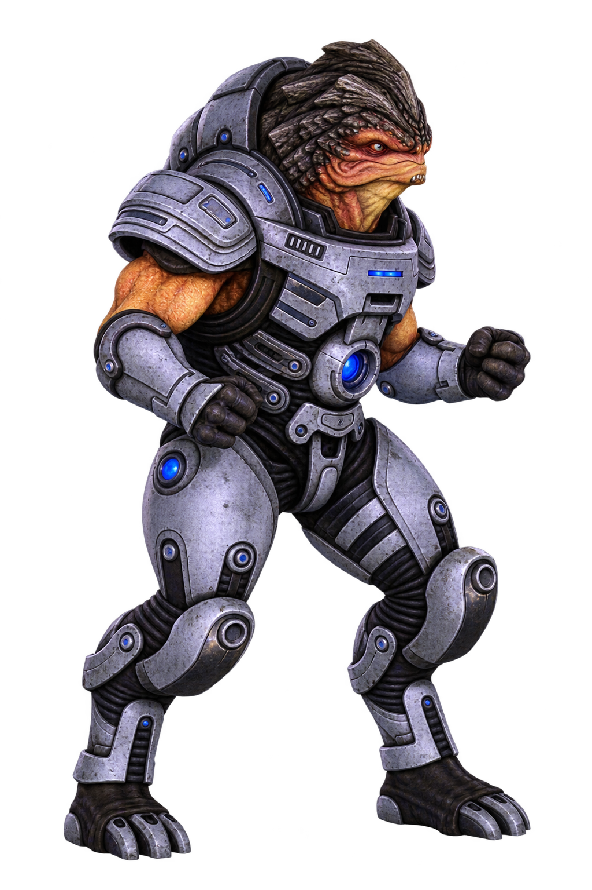
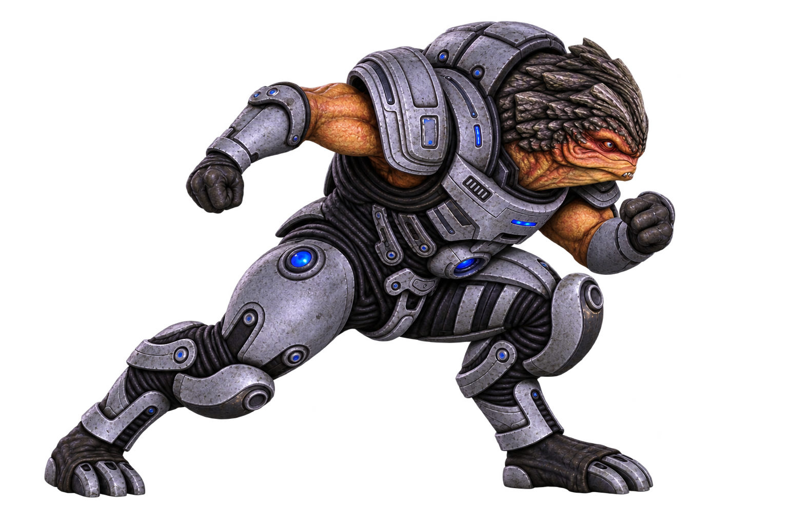
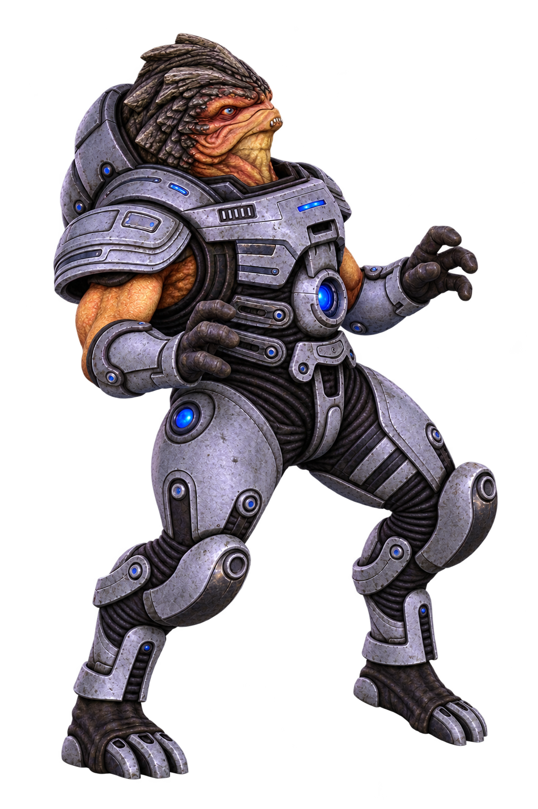
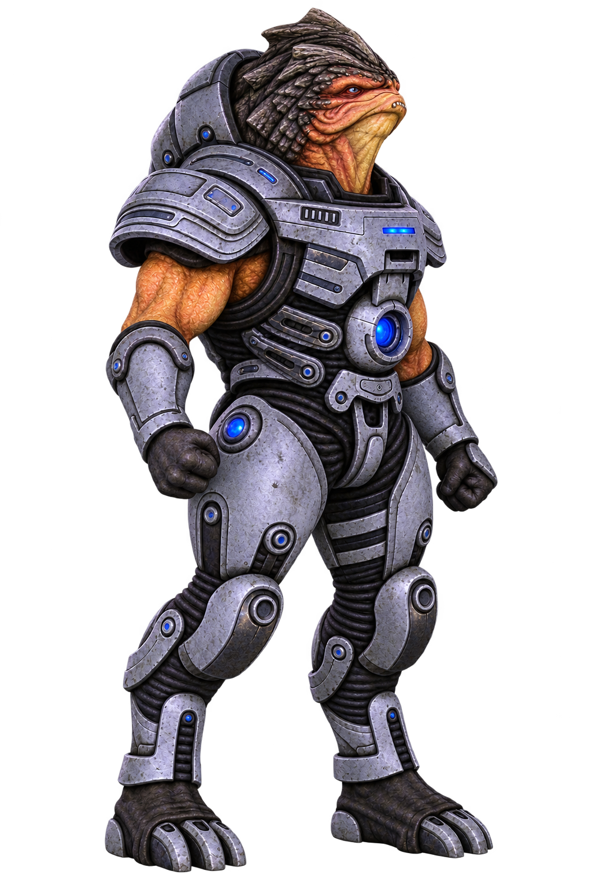
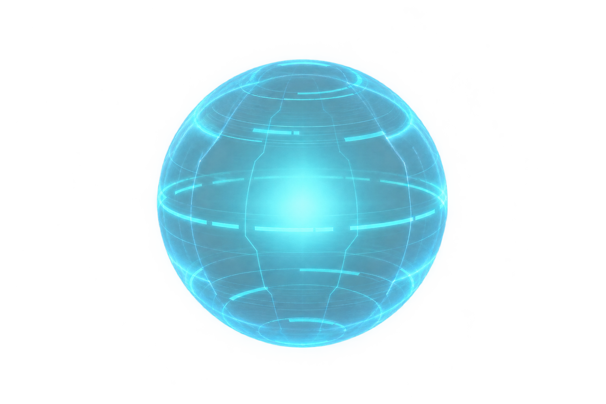
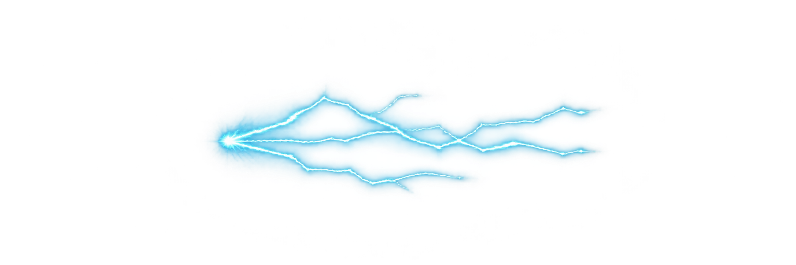
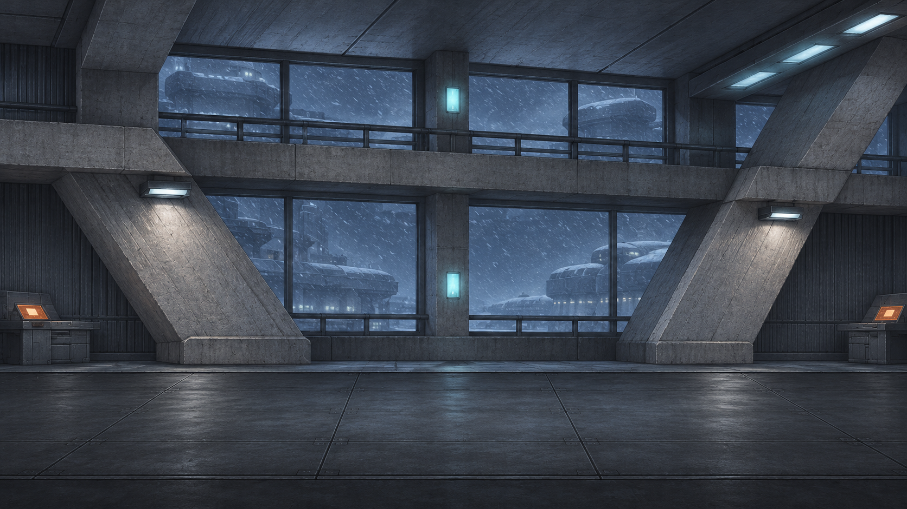
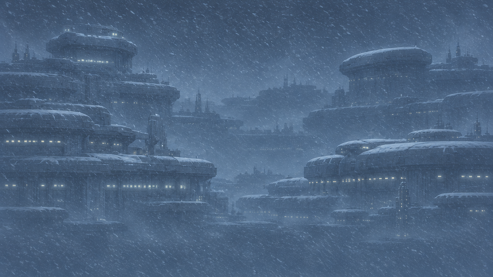
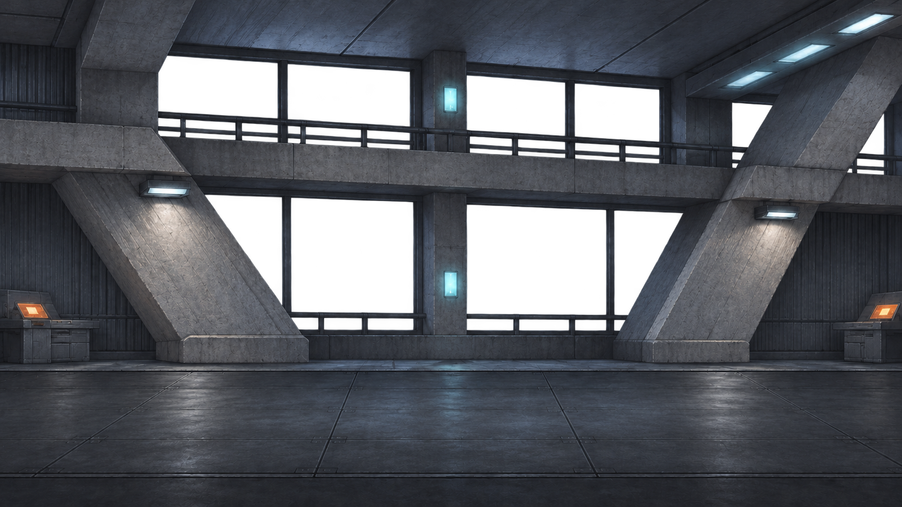
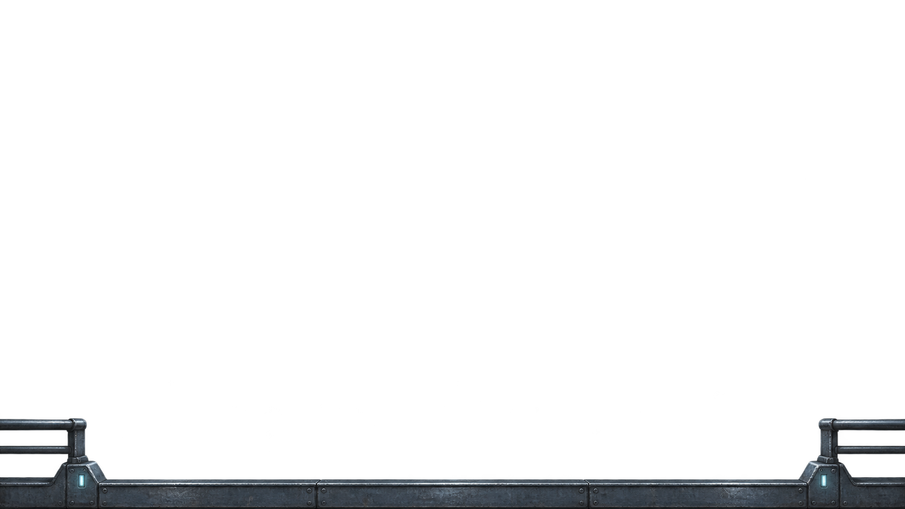

# Combat 2D — galerie du lot du 19 novembre 2026

**10 visuels retenus comme prototypes, un premier essai conservé dans l'historique.** Un sujet ou une couche par PNG. Les quatre images de Grunt sont des poses clés fixes. La fidélité 1:1, les cycles animés et le combat jouable restent à valider ou produire.

[Conception](CONTINUATION_2026-11-19.md) · [Suivi et manquants](production.json) · [Références](SOURCES_2026-11-19.md)

## Grunt — quatre poses

### Garde

Seconde version fondée sur la page 2 du guide officiel. Corps entier, armure grise et pieds krogan. Détails du visage, doigts, volumes et panneaux à comparer avant validation.

### Percée physique — pose de contact

Une pose clé de charge physique vers la droite. Anticipation, translation, collisions et récupération restent à produire ; aucun pouvoir biotique attribué.

### Réaction à un impact

Une pose clé de recul, sans blessure. Continuité du volume, main ouverte et retour à la garde restent à contrôler et animer.

### Victoire — maintien

Pose fixe debout, poings abaissés. Entrée, respiration et sortie de pose absentes.

## Drone de Legion — corps et effet séparés

### Attente — noyau holographique cyan

\n
Source secondaire identifie la couleur bleu/orange selon évolution. Géométrie, grille et anneaux interprétés, référence primaire détaillée manquante. Ni drone mécanique ME1 ni variante rose de Tali.

### Effet de décharge séparé

\n
Effet isolé à superposer au drone. Proposition visuelle cyan, sans fidélité géométrique certifiée. Anticipation, durée, impact et dissipation restent à animer.

## Port Hanshan — référence et trois plans

L'assemblage se fait dans l'ordre **extérieur → intérieur et sol → premier plan**. La composition aplatie est une référence : ne pas l'empiler avec l'intérieur. Les trois couches sont des prototypes d'assemblage, pas les sept couches cibles terminées. La neige et l'extérieur restent regroupés, ainsi que le sol et l'architecture.

### Composition de référence aplatie

Adaptation latérale d'après captures IGN 2007 pages 49 et 53. Secteurs et géométrie recomposés. Image aplatie de référence, ne pas l'empiler avec le calque intérieur opaque.

### Extérieur lointain

Plaque extérieure opaque pour être vue à travers les baies du calque intérieur. Architecture recomposée et météo peinte ; ciel/neige non indépendants.

### Architecture intérieure et sol

Architecture/floor regroupés, ouvertures de fenêtres transparentes. Alignement avec extérieur à contrôler ; collision indépendante à implémenter.

### Bordure de premier plan

Calque transparent de rebord bas et éléments latéraux. Composition ajoutée pour le versus ; ne représente pas un prop canonique isolé validé.

## Historique non retenu

[Première garde de Grunt](history/grunt-me2-guard-v1.png) conservée pour la traçabilité. Elle a été remplacée par la version fondée sur la page 2 du guide officiel ; ne pas l'utiliser comme référence de la famille suivante.

## Éléments encore absents

Le Claymore n'a pas été produit : deux générations ont été refusées par l'outil. Les références et les critères restent dans le suivi. Les anciens documents de 99 pages et les Lot02/Lot03 n'ont pas été retrouvés dans cette reprise. Les 36 lignes du registre concernent ce lot et ses suites ; ce n'est pas un décompte exhaustif de tout le jeu.
